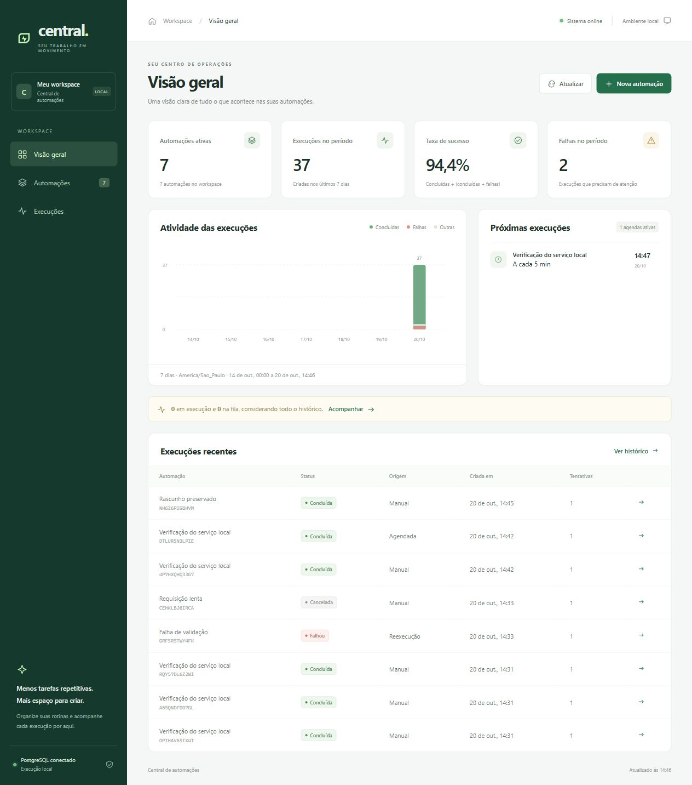

# Validação do painel local

Executada em 20/10/2026, no Windows, com Go 1.27.2, Node 24 e PostgreSQL 18 em Docker. O navegador acessou um binário real em loopback, com banco exclusivo de validação e o destino HTTP `cmd/fixture`. Os dados do banco habitual da aplicação não foram usados pelos cenários do navegador.

## Verificações de código e artefato

- `go test ./...`: aprovado, com `TEST_DATABASE_URL` configurado para PostgreSQL real e schemas isolados.
- `go vet ./...`: aprovado.
- Compilação do executável: aprovada.
- `npm run check`: aprovado.
- `npm test`: 21 testes aprovados.
- Binário iniciado em uma pasta vazia, sem assets externos: `/`, JavaScript e CSS responderam 200; `/health` manteve JSON; `/.env`, `/assets/.env` e arquivo inexistente responderam 404.
- O HTML e os assets apresentaram CSP com recursos locais. A revisão independente de código terminou sem bloqueadores pendentes.

## Resultados por critério

| Critério | Resultado e evidência |
|---|---|
| VAL-P01 | Aprovado: assets embutidos no binário, inclusive a partir de outra pasta; API preservada nos testes HTTP e nas chamadas reais. |
| VAL-P02 | Aprovado: requests reais 404 para configurações/arquivos ausentes, testes de caminhos e CSP. |
| VAL-P03 | Aprovado: testes de calendário, timezone, DST, taxa sem denominador e contagens exatas; stores exercitados com 508 execuções no período, sem corte artificial de 500. Overview vazio e populado verificados no navegador. |
| VAL-P04 | Aprovado: overview, automações, histórico e detalhes, links profundos, Back e reload reais. |
| VAL-P05 | Aprovado: cadastro HTTP pelo formulário, execução concluída com HTTP 200 e tentativa persistida; validação cron do servidor e perda de conexão conservaram o formulário. Validações de JSON/limites cobertas também pelos testes do modelo. |
| VAL-P06 | Aprovado: edição do nome pelo navegador preservou exatamente o corpo com CRLF, headers e `next_run_at`; comparação antes/depois registrada localmente. PATCH parcial e configuração completa cobertos pelos testes do formulário. |
| VAL-P07 | Aprovado: intervalo e cron com America/Sao_Paulo criados pela interface; próximo horário apresentado, pausa/retomada e remoção exercitadas. O scheduler também produziu execução agendada real. |
| VAL-P08 | Aprovado: retry customizado criado e removido pelo formulário; retorno à política herdada confirmado pela API. Reset, conflito e preservação dos snapshots cobertos nos dois stores. |
| VAL-P09 | Aprovado: busca, inclusão de arquivadas, desabilitação e arquivamento confirmado verificados; histórico/detalhe preservados e execução desabilitada na interface. Escape dispensou uma confirmação. |
| VAL-P10 | Aprovado: 25 itens na primeira página e quatro na segunda; execução criada entre páginas não deslocou os IDs. Back e reload mantiveram página/corte. Atualizar retornou à página 1 e incluiu o novo ID. |
| VAL-P11 | Aprovado: acompanhamento automático até conclusão, cancelamento com confirmação passando por Cancelando e Cancelada; formulário de filtro preservado durante polling. Pendentes e semântica de reservas cobertos nos testes Go. |
| VAL-P12 | Aprovado: reexecução de uma falha gerou novo ID e vínculo à original; estados e snapshot original cobertos também por domínio/API/stores. |
| VAL-P13 | Aprovado: resposta extensa mostrou aviso de 4 KiB; fixture flaky mostrou duas tentativas reais, HTTP 503 seguido de 200, horários, erro e duração. |
| VAL-P14 | Aprovado: proxy interrompido produziu erro explícito na página; restabelecimento e Atualizar recuperaram os dados. Formulário conservou o draft após falha e salvou ao reconectar. Duplo clique em Executar gerou exatamente uma execução, confirmado pela API (0 → 1). |
| VAL-P15 | Aprovado: nome com tag HTML e atributo de evento apareceu como texto no navegador; headers/body são escapados. Testes de escape e entradas adversariais aprovados. |
| VAL-P16 | Aprovado: labels, navegação por teclado, Escape, foco de diálogo e botão Aplicar preservados. Em viewport de 390 px, documento com 375 px e tabela com rolagem interna; sem overflow horizontal global. Capturas desktop/mobile abaixo. |
| VAL-P17 | Aprovado: verificações de código, binário, guia e launcher existentes compatíveis; nenhuma dependência frontend necessária para executar. Servidores temporários encerrados ao finalizar. |
| VAL-P18 | Aprovado: testes incluem trabalhos ativos anteriores ao período, mapa global por automação e conjunto acima de 500; políticas de admissão verificadas nos stores e botões. |
| VAL-P19 | Aprovado: testes de clone/concorrência em memória e teste PostgreSQL controlado com commit entre consultas comprovaram snapshot coerente em transação read-only repeatable-read. |
| VAL-P20 | Aprovado: proxy atrasou detalhe A em 4500 ms; navegação a B permaneceu em B. Dashboard atrasado em 7000 ms não apagou data ainda não aplicada nem foco no botão Aplicar. Troca explícita de automação limpou o draft do contexto anterior. |

As verificações combinam testes automatizados, revisão de código e os fluxos de navegador descritos; não representam uma execução automática de todas as combinações possíveis de configuração. `-race` não foi executado neste ambiente sem suporte CGO.

As evidências auxiliares ficam em `.local/panel/`, ignorado pelo Git. As capturas abaixo usam somente dados locais de teste.

[Captura em tela de celular](images/panel-mobile.png)

Para repetir os fluxos, inicie a central e `go run ./cmd/fixture`, abra o painel e use os destinos `/health`, `/flaky`, `/slow`, `/large` e uma rota inexistente. Para ensaios que criam muitos registros, use um banco exclusivo; o guia de testes PostgreSQL no README descreve a configuração de `TEST_DATABASE_URL`.
